

  

### I'm Kashif. I build a model, then try to prove it wrong.

Most of my projects start with a baseline that is annoyingly hard to beat. Sometimes I beat it and sometimes I don't, and the terminal below shows both. The two studies that ended in "it did not help" taught me more than the wins.

  

  <a href="https://github.com/kasheww-nutt/delhi-aqi-agentic-forecast"></a>
  <a href="https://github.com/kasheww-nutt/AgriMinds"></a>
  
  <a href="https://github.com/kasheww-nutt/speculative-decoding-multilingual"></a>

  

  <a href="https://github.com/kasheww-nutt/lean-muscle-tracker"></a>
  <a href="https://civicpulseai-elfi.onrender.com"></a>

  

  

  

  <a href="https://www.linkedin.com/in/kashif-shaik721/">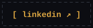</a>
  <a href="mailto:shaikkashif40@gmail.com">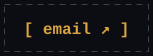</a>
   
  B.Tech AI and ML · SIT Pune · class of 2028 · CivicPulse code: <a href="https://github.com/kasheww-nutt/CivicPulseAI">repo</a>

