  

### I build a model, then try to prove it wrong.

Most of my projects start with a baseline that is annoyingly hard to beat. Sometimes I beat it and sometimes I don't, and the terminal above shows both. The two studies that ended in "it did not help" taught me more than the wins.

Right now: next-day air quality forecasting for Delhi, and learning data structures properly.

### The experiments

| | Question | What happened |
|---|---|---|
| 🟢 | [**Can a model beat "tomorrow = today" for Delhi air quality?**](https://github.com/kasheww-nutt/delhi-aqi-agentic-forecast) | Narrowly. Macro-F1 0.600 against 0.583 on a held-out year, across 34 stations. It only won once I added a physics forecast as a feature. |
| 🟢 | [**Do three CNNs together beat the best one?**](https://github.com/kasheww-nutt/AgriMinds) | On hard crops, yes. Wheat went from 88.0% to 91.0%. On easy crops it changed almost nothing. |
| 🟡 | **Does diffusion-generated sensor data help stress detection?** | No. Across 15 leave-one-subject-out folds nothing was significant. The classifier was already at 0.90 with 5% of the data. |
| 🔴 | [**Is speculative decoding faster in Hindi and Urdu?**](https://github.com/kasheww-nutt/speculative-decoding-multilingual) | Not on my laptop. 0.92x at best, because the small model was not cheap enough. Urdu accepted the fewest draft tokens. |

### Things I built that people can use

- [**Fitness tracker**](https://github.com/kasheww-nutt/lean-muscle-tracker): Next.js and SQLite with OAuth, Docker, and 14 test files that run on every push.
- [**CivicPulse AI**](https://github.com/kasheww-nutt/CivicPulseAI): photograph a pothole and the app files the report. Built in a week for a hackathon. [Try it](https://civicpulseai-elfi.onrender.com) (takes about 30 seconds to wake up).

### Stack

`Python` `PyTorch` `scikit-learn` `LightGBM` `Hugging Face` · `TypeScript` `React` `Next.js` `FastAPI` · `Java` `SQL` · `Docker` `GitHub Actions`

### Say hi

[LinkedIn](https://www.linkedin.com/in/kashif-shaik721/) · [shaikkashif40@gmail.com](mailto:shaikkashif40@gmail.com) · B.Tech AI and ML, SIT Pune, class of 2028
